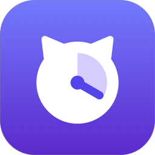
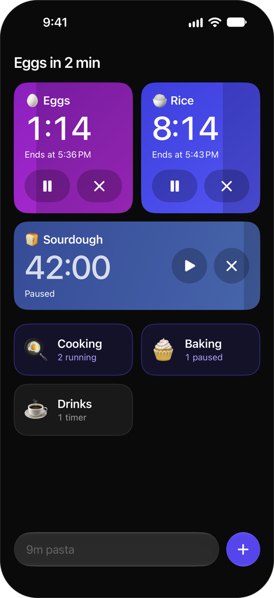
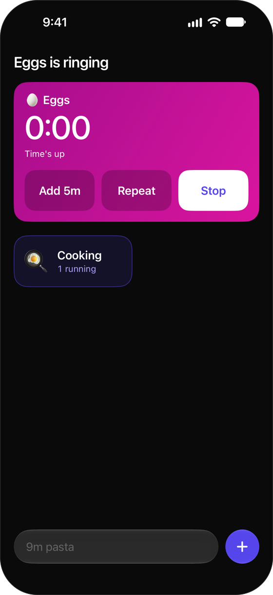
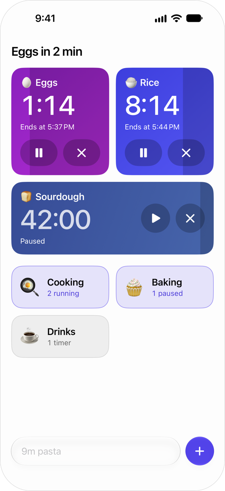
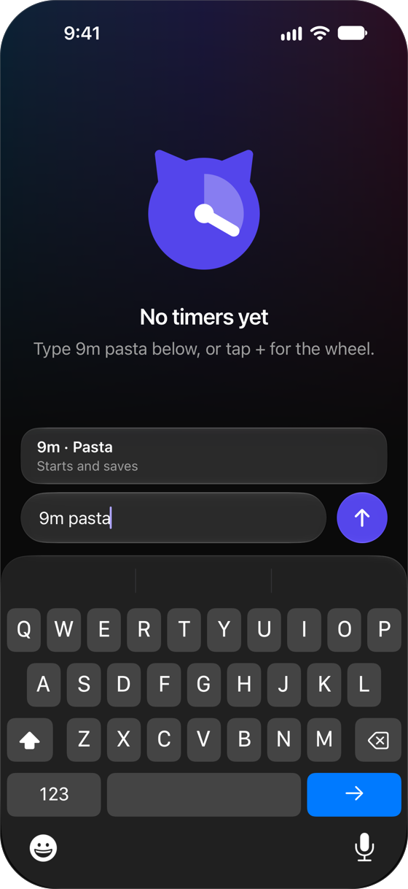
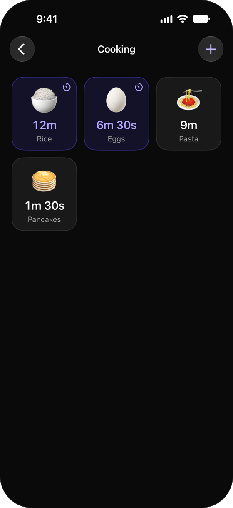
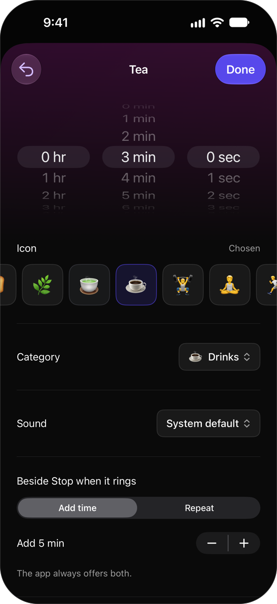
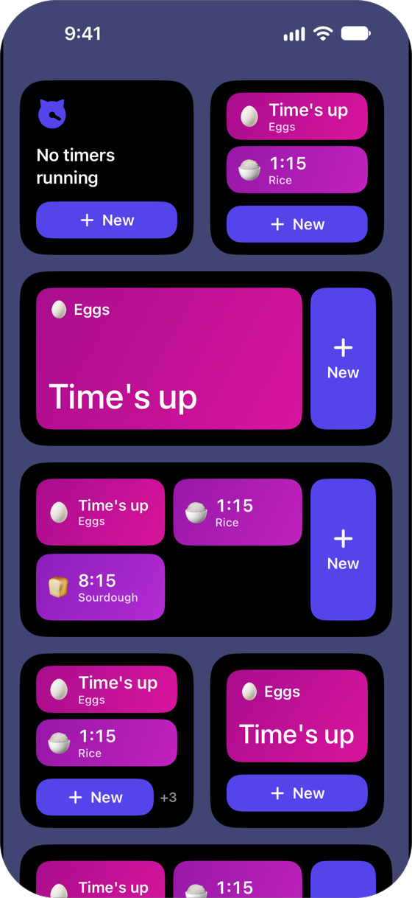

<p align="center">
  
</p>

<h1 align="center">Timing</h1>

<p align="center">
  <strong>An iPhone timer with labels.</strong><br>
  Save the timers you cook with, start any of them with one tap, and run several at once.
</p>

<p align="center">
  <sub>iOS 26.1 or later · Swift 6 · <a href="LICENSE">MIT license</a></sub>
</p>

<p align="center">
  
  
  
</p>

## What it does

- **Rings through Silent mode and Focus**, using Apple's AlarmKit.
- **Categories**: saved timers are grouped into Quick, Cooking, Baking, Drinks, Exercise, Everyday and Other. The main screen shows the categories; tap one to see its timers. A timer joins the category its label suggests (Pasta goes to Cooking) unless one is chosen in the editor. The most used categories come first.
- **Saved timers**: a large icon, chosen or taken from the label, and each tap starts one, even beside one already running, then goes back to the main screen. The most used come first. First launch brings 5, 10 and 15 minutes under Quick, plus presets in every other category, all of which can be edited or deleted.
- **Quick start**: type `9m pasta` to start and save it, `9m` to run once, or `pasta` to start the saved one. A timer made with + is saved and starts too.
- **Add time or Repeat** beside Stop when a timer rings, chosen per timer. Inside the app both are always there.
- **Color**: a running timer moves from bright blue through violet to magenta as it nears zero.
- **Outside the app**: Live Activities with Pause and Stop, the Dynamic Island showing the timer closest to ringing, a Home Screen widget of running timers with a New button, a Lock Screen widget that starts a timer you choose, a Control Center button, and "Start Pasta in Timing" for Siri.
- **Private**: no account, no network code, no analytics. Timers stay on the phone.

<table>
  <tr>
    <td align="center" valign="top" width="25%"><br><b>Quick start</b><br><sub>Just type <code>9m pasta</code></sub></td>
    <td align="center" valign="top" width="25%"><br><b>Categories</b><br><sub>Timers sorted for you</sub></td>
    <td align="center" valign="top" width="25%"><br><b>Icons</b><br><sub>Chosen or from the label</sub></td>
    <td align="center" valign="top" width="25%"><br><b>Widgets</b><br><sub>Running timers at a glance</sub></td>
  </tr>
</table>

## Build

You need Xcode 27, [XcodeGen](https://github.com/yonaskolb/XcodeGen) and an iPhone on iOS 26.1 or later.

```sh
brew install xcodegen
xcodegen generate
open Timing.xcodeproj
```

The Xcode project is generated and not committed, so run `xcodegen generate` after changing `project.yml` or adding a file.

To run on a phone, create `Config/Local.xcconfig` (git ignores it) with your team and a prefix of your own:

```
DEVELOPMENT_TEAM = XXXXXXXXXX
BUNDLE_PREFIX = com.example
```

A free developer account works, with Apple's limits of three such apps on one phone and 10 new App IDs in 7 days.

## Test

```sh
cd Core && swift test
xcodebuild test -project Timing.xcodeproj -scheme Timing -destination 'platform=iOS Simulator,name=iPhone 18 Pro'
```

`Core` tests cover the rules. The UI tests drive the app against a stand-in for AlarmKit that really counts down (the iOS 27 simulator refuses alarm permission), so they never set a real alarm.

Check these by hand on a phone before a release:

- With the phone locked and the app closed, a timer rings, and Add time, Repeat and Stop each work over several rounds.
- Two timers ringing together can both be stopped.
- Pause, Resume and Stop work from the Live Activity, and the app agrees on the time left.
- Each widget, the Control Center button and Siri start a timer with the app closed.

After a change to how the app looks, run `Scripts/screenshots.sh` to refresh the logo and screenshots in this README. It runs the UI tests on a fresh simulator with a clean status bar and keeps the screens they capture.

## How it is laid out

| Folder | Contents |
|---|---|
| `Core` | Swift package with every rule and no UI. Knows AlarmKit only through the `TimerClient` protocol. |
| `App` | SwiftUI screens |
| `Shared` | Built into the app and the widget extension: AlarmKit client, intents, shared colors and symbol |
| `Widget` | Live Activity, widgets and Control Center button |
| `UITests` | UI tests, run with `-uiTesting` |
| `Scripts` | Generate the icon, the symbol, the tones and the README images. Each file's first lines show how to run it. |
| `docs` | README images, and [what AlarmKit does on a real phone](docs/alarmkit-findings.md) |

### Decisions worth knowing

- **Categories and tiles are sorted when the app opens,** never while it is in use, so a tile does not move under a finger.
- **Each run is its own alarm and carries a copy of its timer.** Editing or deleting a saved timer never changes one that is running.
- **Add time and Repeat schedule the next countdown first,** then end the current one, so a failure leaves the timer as it was.
- **AlarmKit decides the state; the app keeps the time.** An alarm does not say when it ends, so the app stores it and corrects it from the Live Activity.
- **A ring always has a second button.** After another ring, iOS 27.2 can show nothing at all for a countdown with only Stop.
- **An unreadable file is never treated as empty,** so timers are not cancelled by mistake.

## Known limits

- iOS allows one button beside Stop on the ring screen.
- While the phone is unlocked, iOS shows the ring buttons as symbols without text.
- Restarting the phone while a timer runs is untested.
- The interface is in English only.

## License

[MIT](LICENSE)
